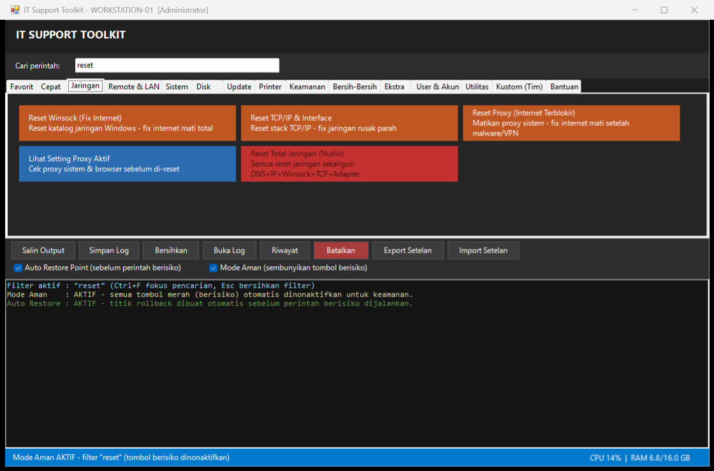

# IT Support Toolkit


Aplikasi bantu untuk teknisi IT support yang menghimpun **218 perintah diagnosa dan perbaikan** dalam satu antarmuka siap pakai. Dirancang agar pengecekan, perbaikan jaringan, pemeliharaan sistem, audit keamanan, hingga pelaporan ke tiket dapat dilakukan cepat tanpa harus menghafal sintaks CLI.

- **Windows 10/11**: GUI WinForms siap pakai berisi 171 perintah dalam 12 tab kategori, plus tab Favorit, Kustom (Tim), dan Bantuan. Tanpa instalasi tambahan, cukup PowerShell 5.1 bawaan Windows.
- **Linux & macOS**: menu terminal interaktif berisi 47 perintah (32 Linux dan 15 macOS) melalui [PowerShell Core (`pwsh`)](https://aka.ms/powershell).
- **Ekosistem Tim**: dilengkapi dashboard web lokal (`WEB-Dashboard.ps1`), utilitas audit sintaks (`AUDIT-Perintah.ps1`), builder `.exe` opsional (`BUAT-EXE.ps1`), dan dukungan perintah kustom tim (`kustom.json`).


---

## Daftar Isi

- [Tangkapan Layar](#tangkapan-layar)
- [Fitur Utama](#fitur-utama)
- [Cara Menjalankan](#cara-menjalankan)
- [Katalog Perintah](#katalog-perintah)
- [Dashboard Web Lokal](#dashboard-web-lokal)
- [Mode Script (CLI / Otomasi)](#mode-script-cli--otomasi)
- [Perintah Kustom Tim](#perintah-kustom-tim)
- [Audit Sintaks dan Build EXE](#audit-sintaks-dan-build-exe)
- [Struktur Proyek](#struktur-proyek)
- [Catatan Keamanan dan Penggunaan](#catatan-keamanan-dan-penggunaan)
- [Riwayat Perubahan](#riwayat-perubahan)

---

## Tangkapan Layar

### Tab Jaringan dan Speed Test

Menyediakan 28 perintah diagnosa serta perbaikan jaringan (IP, DNS, Winsock, WiFi, proxy, port, hingga pengukuran kecepatan unduh via Cloudflare) dengan output langsung di panel bawah.


### Pencarian Real-Time dan Mode Aman

Ketik kata kunci di kotak pencarian (`Ctrl+F` untuk fokus, `Esc` untuk membersihkan) untuk memfilter tombol dan berpindah otomatis ke tab yang relevan. Saat **Mode Aman** dicentang, seluruh tombol berisiko (merah) dinonaktifkan agar aman digunakan teknisi junior atau saat pendampingan client.



### Tab Utilitas (Shortcut Panel Windows)

Akses satu klik ke 24 panel administrasi Windows seperti Task Manager, Device Manager, Disk Management, Services, Event Viewer, Registry Editor, hingga Remote Desktop (`mstsc`).


---

## Fitur Utama

| Fitur | Deskripsi |
|---|---|
| **Diagnosa Pintar + Rekomendasi** | Menjalankan cek gateway, koneksi internet, DNS, ruang disk C:, Windows Defender, dan uptime, lalu menganalisa hasilnya dan menampilkan saran perbaikan spesifik. |
| **Laporan Diagnosa HTML** | Mengumpulkan data OS, hardware, disk, hotfix, jaringan, error sistem, dan startup ke file HTML di Desktop (`Laporan-Diagnosa-<PC>-<waktu>.html`) yang siap dilampirkan ke tiket. |
| **Perlindungan Eksekusi** | Dialog konfirmasi pada perintah berisiko, **Auto Restore Point** otomatis sebelum tindakan merah, tombol **Batalkan** untuk menghentikan proses lama, serta **Mode Aman**. |
| **Diagnosa PC Remote & Scan LAN** | Memeriksa OS, disk, Defender, dan update komputer lain lewat WinRM, serta melakukan ping sweep subnet beserta tabel ARP (IP-MAC). |
| **Analisa Disk & Speed Test** | Memindai folder terbesar dan file >500 MB pada drive C:, serta mengukur kecepatan unduh internet nyata via Cloudflare. |
| **Maintenance Mingguan** | Memasang atau mencopot tugas terjadwal Windows (`ITToolkit-Maintenance`) untuk menjalankan pembersihan AIO tiap Minggu pukul 09:00. |
| **Kustom Tim & Export Setelan** | Tambah perintah internal tim lewat `kustom.json` tanpa mengubah skrip utama. Ekspor/impor `favorit.json`, `posisi.json`, dan `kustom.json` dalam satu arsip `.zip`. |
| **Pencatatan & Monitoring** | Semua output dicatat otomatis ke `Logs/`, dilengkapi jendela **Riwayat**, klik kanan untuk **Salin perintah CMD** atau **Pin ke Favorit**, monitor **CPU/RAM live** tiap 2 detik, dan proteksi single-instance. |
| **Kamus Error Windows** | Referensi kode error umum (`0x80070005`, `0x80070002`, `0x800F0954`, `0xC1900200`, dan lainnya) beserta langkah penanganan di tab **Bantuan**. |

---

## Cara Menjalankan

### Prasyarat

- **Windows**: Windows 10 atau Windows 11 dengan Windows PowerShell 5.1 bawaan dan hak Administrator.
- **Linux / macOS**: [PowerShell Core (`pwsh`)](https://aka.ms/powershell).

### Clone atau Unduh

```bash
git clone https://github.com/aktifkoding/IT-Support-Toolkit.git
cd IT-Support-Toolkit
```

### Windows

1. Klik ganda `JALANKAN-IT-Toolkit.bat`.
2. Setujui dialog **UAC (User Account Control)** karena toolkit otomatis meminta hak Administrator.
3. Pilih tab kategori, lalu klik tombol perintah yang dibutuhkan.

Alternatif: klik kanan `IT-Support-Toolkit.ps1` lalu pilih **Run with PowerShell**, atau jalankan melalui PowerShell:

```powershell
powershell -NoProfile -ExecutionPolicy Bypass -File .\IT-Support-Toolkit.ps1
```

> Jika Windows SmartScreen memblokir file hasil unduhan: klik kanan `IT-Support-Toolkit.ps1` -> **Properties** -> centang **Unblock** -> **OK**.

### Linux & macOS

1. Pasang PowerShell Core jika belum tersedia:
   - Linux (Ubuntu/Debian via Snap): `sudo snap install powershell --classic`
   - macOS (Homebrew): `brew install --cask powershell`
2. Jalankan launcher:

```bash
bash JALANKAN-Linux-Mac.sh
```

Atau jalankan langsung dengan hak penuh (`sudo`):

```bash
sudo pwsh -NoProfile -File ./IT-Support-Toolkit.ps1
```

Skrip mendeteksi sistem operasi secara otomatis. Di Windows muncul antarmuka WinForms, sedangkan di Linux dan macOS muncul menu terminal interaktif dengan katalog sesuai platform.

---

## Katalog Perintah

Kode warna pada tombol GUI Windows:
- **Biru (`check`)**: pemeriksaan dan diagnosa, aman dijalankan tanpa mengubah konfigurasi.
- **Oranye (`fix`)**: perbaikan dan penyesuaian konfigurasi.
- **Merah (`danger`)**: tindakan berisiko, menampilkan dialog konfirmasi dan memicu Auto Restore Point jika aktif.
- **Hijau (`open`)**: membuka panel administrasi atau aplikasi bawaan Windows.

### Windows (171 Perintah, 12 Tab Kategori + Favorit, Kustom, Bantuan)

| Tab | Jumlah | Ringkasan Perintah |
|---|---:|---|
| **Cepat** | 9 | AIO cek & perbaiki cepat, diagnosa jaringan cepat, repair Windows (DISM + SFC), bersih-bersih cepat, cek kesehatan PC, Diagnosa Pintar + Rekomendasi, export laporan HTML, pasang/hapus maintenance mingguan |
| **Jaringan** | 28 | Info IP & MAC, ping gateway/internet, traceroute, tes DNS, routing & ARP, daftar & password WiFi, release/renew IP, flush DNS, reset Winsock/TCP-IP/proxy, set DNS Google/Cloudflare/DHCP, set IP statik/DHCP, diagnosa host, netstat, tes port, shared folders, speed test Cloudflare, reset total jaringan |
| **Remote & LAN** | 3 | Diagnosa PC remote via WinRM, aktifkan WinRM, scan perangkat LAN (subnet ping sweep + ARP IP-MAC) |
| **Sistem** | 23 | `systeminfo`, hardware, slot & kecepatan RAM, status baterai, uptime, 15 log error terakhir, aplikasi startup, program terinstall, lisensi & product key OEM BIOS, status UAC/SmartScreen, SFC, DISM, System Restore, restart/matikan dengan jeda & pembatalan, Advanced Startup (WinRE) |
| **Disk** | 9 | Kapasitas drive, status SMART HDD/SSD, scan & perbaiki drive C:, TRIM/defrag, pembersihan WinSxS, analisa ruang disk C: (folder terbesar + 25 file >500 MB) |
| **Update** | 6 | Versi & build Windows, 15 hotfix terakhir, reset cache Windows Update, troubleshooter Windows Update |
| **Printer** | 5 | Daftar printer & status, cek antrian print, restart Print Spooler, kosongkan seluruh antrian print |
| **Keamanan** | 17 | Status, update definisi, dan scan Windows Defender, firewall, BitLocker, syarat Windows 11 (TPM/Secure Boot), audit exclusion Defender, riwayat USB storage (forensik), riwayat crash aplikasi, riwayat mati tak wajar, scheduled task non-Microsoft |
| **Bersih-Bersih** | 8 | Hapus temp user & Windows, prefetch, Recycle Bin, rebuild icon cache, Storage Sense, pembersihan AIO |
| **Ekstra** | 23 | Winget (cek/upgrade/install), reset & re-register Microsoft Store, laporan baterai, backup driver (`dism /export-driver`), backup profil WiFi, Take Ownership, tampilkan file hidden & ekstensi, hibernasi, sinkronisasi jam NTP, perbaikan audio, power plan, cek driver bermasalah, riwayat BSOD dump, pending reboot, file `HOSTS` |
| **User & Akun** | 16 | Daftar user & grup admin lokal, user login aktif (`quser`), logoff sesi, reset password, wajib ganti password, buat user baru, tambahkan user ke Administrators, cek status domain, kelola akun Administrator bawaan, aktif/nonaktifkan Remote Desktop |
| **Utilitas** | 24 | Shortcut cepat panel Windows (Task Manager, Device Manager, Disk Management, Services, Event Viewer, Regedit, Control Panel, Network Connections, mstsc RDP, Remote Assistance, Quick Assist, dan lainnya) |

### Linux & macOS (47 Perintah via Menu Terminal)

| Platform | Kategori | Jumlah | Contoh Cakupan |
|---|---|---:|---|
| **Linux** (32) | Jaringan | 10 | `ip`/`nmcli`, status WiFi, ping, traceroute, DNS, `ss` listening ports, tes port, flush DNS, restart jaringan, set IP statik (`nmcli`) |
| **Linux** | Sistem | 11 | Info distro/kernel, hardware CPU/RAM/Disk, top proses, systemd services, `journalctl`, log kernel, riwayat reboot, cek update, firewall (`ufw`/`firewalld`), Docker containers, crontab |
| **Linux** | Disk | 4 | `df -h`, folder `/var` terbesar, kesehatan SMART, partisi & filesystem |
| **Linux** | Update & Bersih | 3 | Auto-detect `apt`/`dnf`/`zypper` untuk cek update, upgrade semua paket, dan pembersihan cache/log |
| **Linux** | User | 4 | Daftar user (UID 1000+), buat user, ganti password, tambahkan ke grup `sudo`/`wheel` |
| **macOS** (15) | Sistem, Jaringan, Disk, Update | 15 | `sw_vers`, info hardware, proses aktif, `networksetup`, flush DNS, `diskutil`, `softwareupdate` |

---

## Dashboard Web Lokal

`WEB-Dashboard.ps1` menjalankan server HTTP lokal di `http://127.0.0.1:8098` dengan token acak per sesi, berguna saat teknisi ingin mengeksekusi perintah diagnosa atau perbaikan lewat browser di PC client maupun perangkat lain di jaringan lokal.

```powershell
powershell -NoProfile -ExecutionPolicy Bypass -File .\WEB-Dashboard.ps1
```

Catatan keamanan bawaan:
- Hanya mendengarkan di `127.0.0.1:8098` dan mewajibkan parameter token `?t=<token>` pada setiap permintaan.
- Perintah destruktif (seperti Reset Total Jaringan, Restart/Matikan Komputer, Advanced Startup, CHKDSK terjadwal, dan Kosongkan Log Event) tidak diekspos ke antarmuka web.
- Untuk akses sementara dari HP/laptop di jaringan LAN yang sama, gunakan `netsh interface portproxy` sesuai panduan di bagian komentar atas `WEB-Dashboard.ps1`, lalu hapus aturan `portproxy` segera setelah selesai.

---

## Mode Script (CLI / Otomasi)

Toolkit mendukung eksekusi tanpa GUI melalui parameter `-List` dan `-Run` untuk kebutuhan scripting atau otomasi.

### Windows

```powershell
# Menampilkan daftar seluruh perintah
powershell -NoProfile -ExecutionPolicy Bypass -File .\IT-Support-Toolkit.ps1 -List

# Menjalankan perintah berdasarkan pencocokan nama atau deskripsi
powershell -NoProfile -ExecutionPolicy Bypass -File .\IT-Support-Toolkit.ps1 -Run "Ping"
powershell -NoProfile -ExecutionPolicy Bypass -File .\IT-Support-Toolkit.ps1 -Run "Diagnosa Pintar"
powershell -NoProfile -ExecutionPolicy Bypass -File .\IT-Support-Toolkit.ps1 -Run "Winget"
```

### Linux & macOS

```bash
pwsh -NoProfile -File ./IT-Support-Toolkit.ps1 -List
pwsh -NoProfile -File ./IT-Support-Toolkit.ps1 -Run "Ping"
```

Pencocokan `-Run` memeriksa judul maupun deskripsi perintah. Perintah yang membutuhkan dialog input interaktif tetap dijalankan lewat GUI Windows atau menu terminal.

---

## Perintah Kustom Tim

Tambahkan perintah internal perusahaan tanpa mengedit kode utama:

1. Salin `CONTOH-kustom.json` menjadi `kustom.json` di folder yang sama dengan `IT-Support-Toolkit.ps1`.
2. Ubah daftar perintah sesuai kebutuhan tim (tipe yang didukung: `check`, `fix`, `danger`, atau `open`).
3. Jalankan ulang toolkit; tab **Kustom (Tim)** akan muncul otomatis.

Contoh format `kustom.json`:

```json
[
  {
    "Name": "Backup Folder ke Server",
    "Desc": "Salin C:\\Data ke share server kantor",
    "Type": "fix",
    "Cmds": [
      "robocopy \"C:\\Data\" \"\\\\SERVER-KANTOR\\Backup\\%COMPUTERNAME%\" /MIR /R:1 /W:1"
    ],
    "Note": "Pastikan PC tersambung ke jaringan kantor."
  },
  {
    "Name": "Buka Aplikasi Internal",
    "Desc": "Shortcut aplikasi internal kantor",
    "Type": "open",
    "Target": "notepad.exe"
  }
]
```

Untuk menambahkan item permanen langsung ke katalog inti `IT-Support-Toolkit.ps1`, tambahkan hashtable baru pada array `$Categories` (Windows) atau `$CategoriesNix` (Linux/macOS).

---

## Audit Sintaks dan Build EXE

### Audit Perintah (`AUDIT-Perintah.ps1`)

Memvalidasi sintaks AST skrip utama, seluruh command PowerShell tertanam, sintaks shell (`bash -n`) perintah Linux/macOS, serta dapat menjalankan perintah `check` Windows secara headless untuk pengujian regresi.

```powershell
# Validasi sintaks saja (cepat, tanpa mengeksekusi perintah)
powershell -NoProfile -ExecutionPolicy Bypass -File .\AUDIT-Perintah.ps1

# Validasi sintaks + eksekusi perintah CHECK headless (default timeout 180 detik)
powershell -NoProfile -ExecutionPolicy Bypass -File .\AUDIT-Perintah.ps1 -RunChecks
```

Hasil audit dicatat ke `AUDIT-Report.txt`.

### Build Versi `.exe` Opsional (`BUAT-EXE.ps1`)

Membangun berkas mandiri `IT-Support-Toolkit.exe` menggunakan modul `ps2exe`.

```powershell
# Pasang modul ps2exe (sekali saja, butuh internet) lalu build
powershell -NoProfile -ExecutionPolicy Bypass -File .\BUAT-EXE.ps1 -Install

# Build ulang jika ps2exe sudah terpasang
powershell -NoProfile -ExecutionPolicy Bypass -File .\BUAT-EXE.ps1
```

> Catatan: berkas `.exe` hasil `ps2exe` sering memicu false-positive pada antivirus/Windows Defender. Untuk distribusi harian tanpa perlu membuat exclusion antivirus, gunakan `JALANKAN-IT-Toolkit.bat` bersama `IT-Support-Toolkit.ps1`.

---

## Struktur Proyek

```text
IT-Support-Toolkit/
├── IT-Support-Toolkit.ps1     # Aplikasi utama (GUI Windows, menu terminal Linux/macOS, CLI)
├── JALANKAN-IT-Toolkit.bat    # Launcher Windows sekali klik
├── JALANKAN-Linux-Mac.sh      # Launcher Linux & macOS dengan cek instalasi pwsh
├── WEB-Dashboard.ps1          # Dashboard web lokal bertoken (127.0.0.1:8098)
├── AUDIT-Perintah.ps1         # Alat audit sintaks & uji headless seluruh katalog perintah
├── BUAT-EXE.ps1               # Builder opsional ke .exe via PS2EXE
├── CONTOH-kustom.json         # Template perintah kustom tim (salin ke kustom.json)
├── CHANGELOG.md               # Riwayat perubahan tiap rilis (v1.0 - v6.0)
├── README.md                  # Dokumentasi proyek
└── docs/
    └── screenshots/           # Tangkapan layar aplikasi untuk dokumentasi
```

Berkas yang dibuat otomatis saat aplikasi berjalan (dikecualikan oleh `.gitignore`):
- `Logs/`: riwayat log eksekusi per sesi.
- `favorit.json`: daftar perintah yang di-pin ke tab Favorit.
- `posisi.json`: koordinat dan ukuran terakhir jendela GUI.
- `kustom.json`: konfigurasi perintah internal tim (dibuat lokal dari `CONTOH-kustom.json`).

---

## Catatan Keamanan dan Penggunaan

- **Hak Administrator**: beberapa perintah Windows membutuhkan elevasi penuh; toolkit otomatis meminta UAC saat dibuka.
- **Restart setelah perbaikan inti**: jalankan restart setelah Reset Winsock/TCP-IP, Reset Cache Windows Update, CHKDSK, atau Reset Total Jaringan agar perubahan diterapkan sepenuhnya.
- **Durasi perintah berat**: perintah seperti SFC (10-30 menit), DISM (15-60 menit), Defender Full Scan (1-3 jam), dan Winget upgrade (5-30 menit) berjalan di latar belakang dengan indikator durasi di status bar dan dapat dihentikan lewat tombol **Batalkan**.
- **Backup WiFi**: fitur ekspor profil WiFi (`key=clear`) menghasilkan berkas XML berisi kata sandi dalam bentuk teks terbuka. Simpan secara aman dan hapus setelah selesai dipakai.
- **Auto Restore Point**: membutuhkan System Restore aktif pada drive sistem (tersedia tombol pengaturannya di tab Sistem).

---

## Riwayat Perubahan

Lihat [CHANGELOG.md](CHANGELOG.md) untuk daftar lengkap pembaruan dari v1.0 hingga v6.0.
