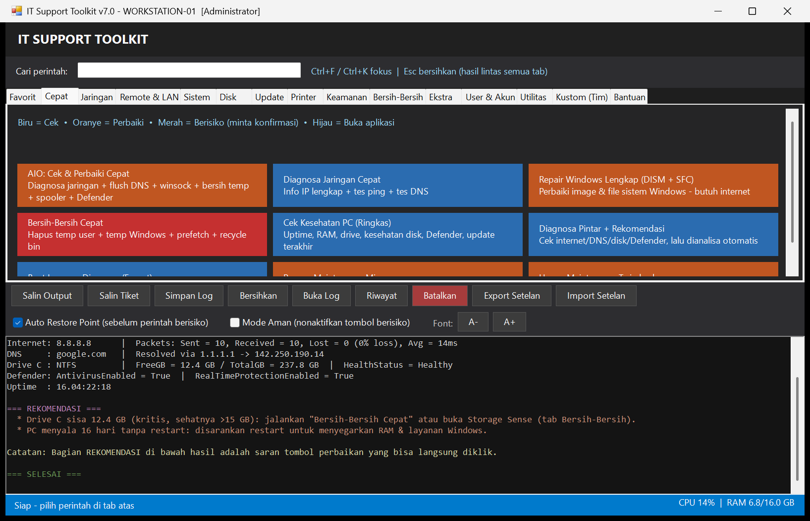
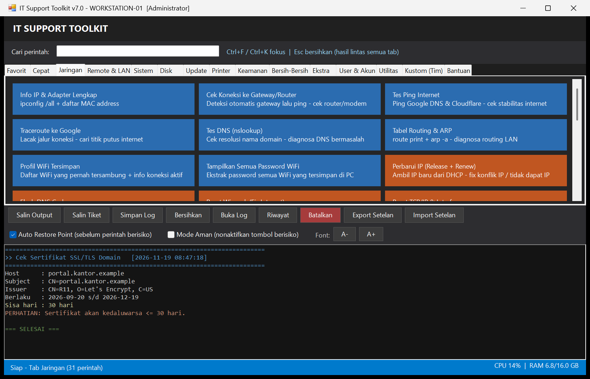
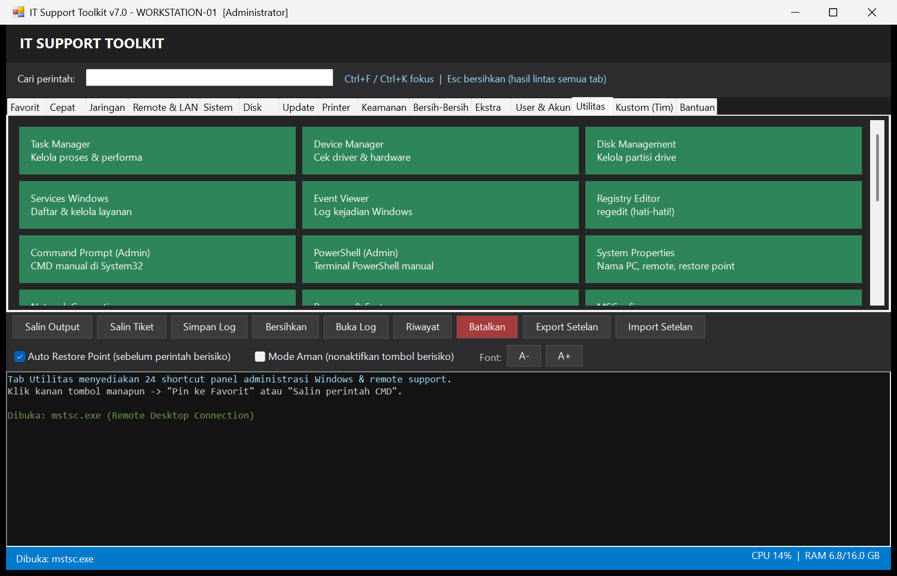
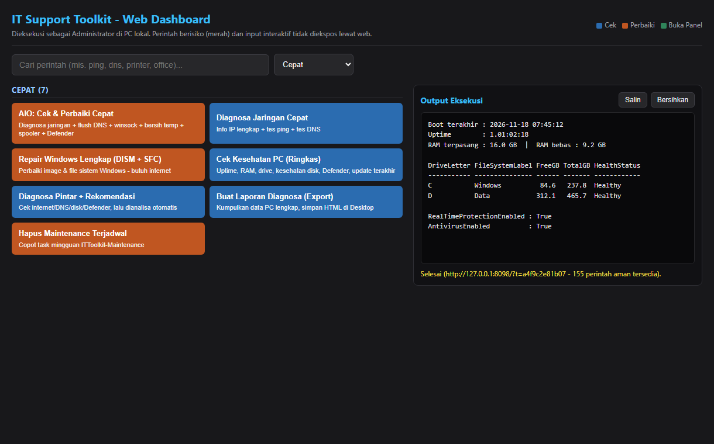
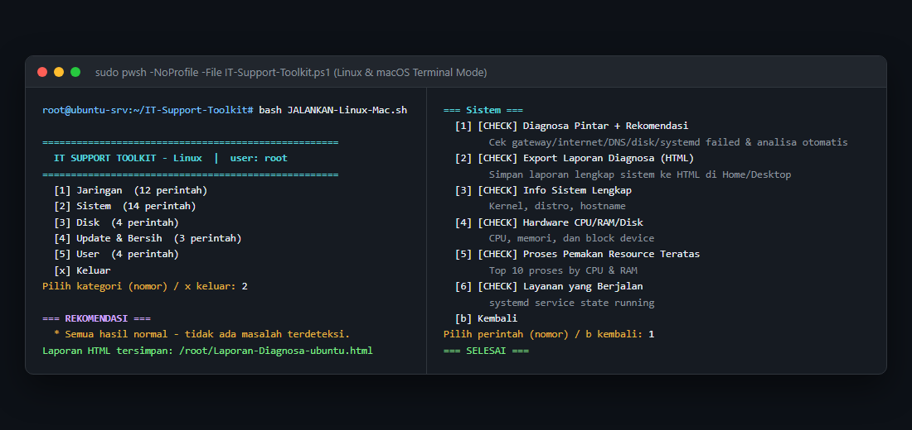

# IT Support Toolkit

[](https://github.com/aktifkoding/IT-Support-Toolkit/actions/workflows/audit.yml)


[](LICENSE)

Aplikasi bantu untuk teknisi IT support yang menghimpun **242 perintah diagnosa dan perbaikan** dalam satu antarmuka siap pakai. Dirancang agar pengecekan, perbaikan jaringan, penanganan tiket harian (Office, Teams, browser, printer), persiapan migrasi PC, audit keamanan, hingga pelaporan ke tiket dapat dilakukan cepat tanpa harus menghafal sintaks CLI.

- **Windows 10/11**: GUI WinForms HiDPI siap pakai berisi **184 perintah** dalam 12 tab kategori, plus tab Favorit, Kustom (Tim), Bantuan, dan tab dinamis `Hasil Cari`. Tanpa instalasi tambahan, cukup PowerShell 5.1 bawaan Windows.
- **Linux & macOS**: menu terminal interaktif berisi **58 perintah** (**37 Linux** dan **21 macOS**) melalui [PowerShell Core (`pwsh`)](https://aka.ms/powershell), lengkap dengan Diagnosa Pintar, Export Laporan HTML, dan `kustom.json`.
- **Ekosistem Tim**: dilengkapi dashboard web lokal bertoken (`WEB-Dashboard.ps1`), utilitas audit sintaks (`AUDIT-Perintah.ps1`), builder `.exe` opsional (`BUAT-EXE.ps1`), serta dukungan perintah kustom tim lintas platform (`kustom.json`).



---

## Daftar Isi

- [Tangkapan Layar](#tangkapan-layar)
- [Fitur Utama](#fitur-utama)
- [Cara Menjalankan](#cara-menjalankan)
- [Katalog Perintah](#katalog-perintah)
- [Dashboard Web Lokal](#dashboard-web-lokal)
- [Mode Script (CLI / Otomasi)](#mode-script-cli--otomasi)
- [Perintah Kustom Tim](#perintah-kustom-tim)
- [Audit Sintaks dan Build EXE](#audit-sintaks-dan-build-exe)
- [Struktur Proyek](#struktur-proyek)
- [Catatan Keamanan dan Penggunaan](#catatan-keamanan-dan-penggunaan)
- [Kontribusi dan Lisensi](#kontribusi-dan-lisensi)

---

## Tangkapan Layar

### Tab Jaringan dan Cek Sertifikat SSL/TLS

Menyediakan 31 perintah diagnosa serta perbaikan jaringan (IP, DNS, Winsock, WiFi, proxy, port, IP publik & ISP, status VPN, cek kedaluwarsa SSL/TLS, hingga speed test via Cloudflare).



### Pencarian Lintas-Tab Terpadu dan Mode Aman

Ketik kata kunci di kotak pencarian (`Ctrl+F` atau `Ctrl+K` untuk fokus, `Esc` untuk membersihkan) guna mengumpulkan seluruh tombol yang cocok dari semua tab ke tab `Hasil Cari (N)`. Saat **Mode Aman** aktif, seluruh tombol berisiko (merah) otomatis dinonaktifkan agar aman saat pendampingan client atau digunakan teknisi junior.


### Tab Utilitas (Shortcut Panel Windows)

Akses satu klik ke 24 panel administrasi Windows seperti Task Manager, Device Manager, Disk Management, Services, Event Viewer, Registry Editor, hingga Remote Desktop (`mstsc`).



### Dashboard Web Lokal (`WEB-Dashboard.ps1`)

Antarmuka web lokal (`127.0.0.1:8098` dengan token acak per sesi) untuk menjalankan perintah diagnosa dan perbaikan aman langsung dari browser PC maupun perangkat lain di jaringan lokal.



### Mode Terminal Linux & macOS (`pwsh`)

Saat dijalankan di Linux atau macOS, toolkit menampilkan menu terminal interaktif lengkap dengan Diagnosa Pintar dan Export Laporan HTML.



---

## Fitur Utama

| Fitur | Deskripsi |
|---|---|
| **Diagnosa Pintar + Rekomendasi** | Tersedia di Windows, Linux, dan macOS. Memeriksa jaringan, DNS, disk, keamanan/layanan, lalu menganalisa hasilnya dan mencetak saran perbaikan konkret. |
| **Laporan Diagnosa HTML** | Mengumpulkan data OS, hardware, disk, hotfix, jaringan, error sistem, dan startup ke file HTML (`Laporan-Diagnosa-<Host>-<waktu>.html`) siap dilampirkan ke tiket. |
| **Tiket Helpdesk & Migrasi PC** | Clear cache Microsoft Teams (Classic/New) dan Chrome/Edge tanpa menghapus bookmark/password, cek aktivasi & Quick Repair Office, cek ukuran OST/PST Outlook, Winget export/import aplikasi JSON, backup bookmark, backup driver, WiFi, serta daftar & port printer. |
| **Perlindungan Eksekusi** | Dialog konfirmasi dengan **preview perintah** (password dimasking `***`), **Auto Restore Point** otomatis sebelum tindakan merah, tombol **Batalkan**, serta **Mode Aman**. |
| **Jaringan, Remote & LAN** | Diagnosa PC remote via WinRM, **Wake-on-LAN (Magic Packet)**, scan subnet LAN (IP-MAC), cek IP publik/ISP, status VPN, cek sertifikat SSL/TLS, dan Speed Test Cloudflare. |
| **UX GUI HiDPI & Format Tiket** | Dukungan HiDPI asli, pencarian lintas-tab terpadu (`Ctrl+F` / `Ctrl+K`), tombol **Salin Tiket** (format Markdown untuk Jira/Freshdesk/GLPI), zoom font output (`A-`/`A+`), dan monitor **CPU/RAM live** di kanan status bar. |
| **Kustom Tim & Export Setelan** | Tambah perintah internal tim lintas platform lewat `kustom.json` tanpa mengubah skrip inti. Ekspor/impor `favorit.json`, `posisi.json`, dan `kustom.json` dalam satu `.zip`. |
| **Maintenance & Kamus Error** | Pasang/copot tugas terjadwal pembersihan mingguan (`ITToolkit-Maintenance`) dan referensi kode error Windows umum (`0x80070005`, `0x80070002`, `0x800F0954`, `0xC1900200`) di tab **Bantuan**. |

---

## Cara Menjalankan

### Prasyarat

- **Windows**: Windows 10 atau Windows 11 dengan Windows PowerShell 5.1 bawaan dan hak Administrator.
- **Linux / macOS**: [PowerShell Core (`pwsh`)](https://aka.ms/powershell).

### Unduh atau Clone

Unduh arsip siap pakai dari halaman [Releases](https://github.com/aktifkoding/IT-Support-Toolkit/releases), atau clone repositori:

```bash
git clone https://github.com/aktifkoding/IT-Support-Toolkit.git
cd IT-Support-Toolkit
```

### Windows

1. Klik ganda `JALANKAN-IT-Toolkit.bat`.
2. Setujui dialog **UAC (User Account Control)** karena toolkit otomatis meminta hak Administrator.
3. Pilih tab kategori atau tekan `Ctrl+F` / `Ctrl+K` untuk mencari perintah lintas semua tab.

Alternatif melalui PowerShell:

```powershell
powershell -NoProfile -ExecutionPolicy Bypass -File .\IT-Support-Toolkit.ps1
```

> Jika Windows SmartScreen memblokir file hasil unduhan: klik kanan `IT-Support-Toolkit.ps1` -> **Properties** -> centang **Unblock** -> **OK**.

### Linux & macOS

1. Pasang PowerShell Core jika belum tersedia:
   - Linux (Ubuntu/Debian via Snap): `sudo snap install powershell --classic`
   - macOS (Homebrew): `brew install --cask powershell`
2. Jalankan launcher:

```bash
bash JALANKAN-Linux-Mac.sh
```

Atau jalankan langsung dengan hak penuh (`sudo`):

```bash
sudo pwsh -NoProfile -File ./IT-Support-Toolkit.ps1
```

Skrip mendeteksi sistem operasi secara otomatis: GUI WinForms di Windows, dan menu terminal interaktif di Linux maupun macOS.

---

## Katalog Perintah

Kode warna pada tombol GUI Windows:
- **Biru (`check`)**: pemeriksaan dan diagnosa, aman dijalankan tanpa mengubah konfigurasi.
- **Oranye (`fix`)**: perbaikan dan penyesuaian konfigurasi.
- **Merah (`danger`)**: tindakan berisiko, menampilkan dialog konfirmasi beserta preview perintah dan memicu Auto Restore Point jika aktif.
- **Hijau (`open`)**: membuka panel administrasi atau aplikasi bawaan Windows.

### Windows (184 Perintah, 12 Tab Kategori + Favorit, Kustom, Bantuan)

| Tab | Jumlah | Ringkasan Perintah |
|---|---:|---|
| **Cepat** | 9 | AIO cek & perbaiki cepat, diagnosa jaringan cepat, repair Windows (DISM + SFC), bersih-bersih cepat, cek kesehatan PC, Diagnosa Pintar + Rekomendasi, export laporan HTML, pasang/hapus maintenance mingguan |
| **Jaringan** | 31 | Info IP & MAC, ping gateway/internet, traceroute, tes DNS, routing & ARP, daftar & password WiFi, release/renew IP, flush DNS, reset Winsock/TCP-IP/proxy, set DNS Google/Cloudflare/DHCP, set IP statik/DHCP, diagnosa host, netstat, tes port, shared folders, speed test Cloudflare, cek IP publik & ISP, status VPN & adapter virtual, cek sertifikat SSL/TLS domain, reset total jaringan |
| **Remote & LAN** | 4 | Diagnosa PC remote via WinRM, aktifkan WinRM, scan perangkat LAN (subnet ping sweep + ARP IP-MAC), Wake-on-LAN (Magic Packet) |
| **Sistem** | 23 | `systeminfo`, hardware, slot & kecepatan RAM, status baterai, uptime, 15 log error terakhir, aplikasi startup, program terinstall, lisensi & product key OEM BIOS, status UAC/SmartScreen, SFC, DISM, System Restore, restart/matikan dengan jeda & pembatalan, Advanced Startup (WinRE) |
| **Disk** | 9 | Kapasitas drive, status SMART HDD/SSD, scan & perbaiki drive C:, TRIM/defrag, pembersihan WinSxS, analisa ruang disk C: (folder terbesar + 25 file >500 MB) |
| **Update** | 6 | Versi & build Windows, 15 hotfix terakhir, reset cache Windows Update, troubleshooter Windows Update |
| **Printer** | 5 | Daftar printer & status, cek antrian print, restart Print Spooler, kosongkan seluruh antrian print |
| **Keamanan** | 17 | Status, update definisi, dan scan Windows Defender, firewall, BitLocker, syarat Windows 11 (TPM/Secure Boot), audit exclusion Defender, riwayat USB storage (forensik), riwayat crash aplikasi, riwayat mati tak wajar, scheduled task non-Microsoft |
| **Bersih-Bersih** | 10 | Hapus temp user & Windows, prefetch, Recycle Bin, rebuild icon cache, Clear Cache Microsoft Teams, Clear Cache Browser (Chrome & Edge), Storage Sense, Disk Cleanup, pembersihan AIO |
| **Ekstra** | 30 | Winget (cek/upgrade/install/export JSON/import JSON), reset & re-register Microsoft Store, laporan baterai, backup driver, backup WiFi, backup bookmark Chrome/Edge, backup daftar & port printer, cek aktivasi & Quick Repair Microsoft Office, cek ukuran OST/PST Outlook, Take Ownership, file hidden & ekstensi, hibernasi, NTP, fix audio, power plan, driver bermasalah, riwayat BSOD dump, pending reboot, file `HOSTS` |
| **User & Akun** | 16 | Daftar user & grup admin lokal, user login aktif (`quser`), logoff sesi, reset password, wajib ganti password, buat user baru, tambahkan user ke Administrators, cek status domain, kelola akun Administrator bawaan, aktif/nonaktifkan Remote Desktop |
| **Utilitas** | 24 | Shortcut cepat panel Windows (Task Manager, Device Manager, Disk Management, Services, Event Viewer, Regedit, Control Panel, Network Connections, mstsc RDP, Remote Assistance, Quick Assist, dan lainnya) |

### Linux & macOS (58 Perintah via Menu Terminal)

| Platform | Kategori | Jumlah | Contoh Cakupan |
|---|---|---:|---|
| **Linux** (37) | Jaringan | 12 | `ip`/`nmcli`, status WiFi, ping, traceroute, DNS, `ss` listening ports, tes port, flush DNS, restart jaringan, set IP statik (`nmcli`), cek IP publik & speed test `curl`, cek sertifikat SSL |
| **Linux** | Sistem | 14 | Diagnosa Pintar + Rekomendasi, Export Laporan HTML, info distro/kernel, hardware, top proses, systemd running & `systemctl --failed`, `journalctl`, log kernel, riwayat reboot, cek update, firewall (`ufw`/`firewalld`), Docker containers, crontab |
| **Linux** | Disk | 4 | `df -h`, folder `/var` terbesar, kesehatan SMART, partisi & filesystem |
| **Linux** | Update & Bersih | 3 | Auto-detect `apt`/`dnf`/`zypper` untuk cek update, upgrade semua paket, dan pembersihan cache/log |
| **Linux** | User | 4 | Daftar user (UID 1000+), buat user, ganti password, tambahkan ke grup `sudo`/`wheel` |
| **macOS** (21) | Sistem, Jaringan, Disk, Update | 21 | Diagnosa Pintar + Rekomendasi, Export Laporan HTML, `sw_vers`, hardware, proses aktif, `networksetup`, flush DNS, cek IP publik & speed test `curl`, cek sertifikat SSL, `diskutil`, `softwareupdate`, Homebrew (`brew update/outdated` & `brew cleanup`) |

---

## Dashboard Web Lokal

`WEB-Dashboard.ps1` menjalankan server HTTP lokal di `http://127.0.0.1:8098` dengan token acak 12 karakter per sesi, memuat katalog perintah aman Windows beserta `kustom.json` tim.

```powershell
powershell -NoProfile -ExecutionPolicy Bypass -File .\WEB-Dashboard.ps1
```

Perlindungan bawaan:
- Hanya mendengarkan di `127.0.0.1:8098` dan mewajibkan parameter token `?t=<token>` pada setiap permintaan.
- Seluruh perintah berisiko (`Type = danger`) dan perintah yang membutuhkan input interaktif otomatis dikecualikan dari antarmuka web.
- Untuk akses sementara dari HP/laptop di LAN yang sama, gunakan `netsh interface portproxy` sesuai panduan di [SECURITY.md](SECURITY.md), lalu hapus aturan `portproxy` segera setelah sesi selesai.

---

## Mode Script (CLI / Otomasi)

Toolkit mendukung eksekusi tanpa GUI melalui parameter `-List` dan `-Run` untuk kebutuhan scripting atau otomasi.

### Windows

```powershell
# Menampilkan daftar seluruh perintah
powershell -NoProfile -ExecutionPolicy Bypass -File .\IT-Support-Toolkit.ps1 -List

# Menjalankan perintah berdasarkan pencocokan nama atau deskripsi
powershell -NoProfile -ExecutionPolicy Bypass -File .\IT-Support-Toolkit.ps1 -Run "Ping"
powershell -NoProfile -ExecutionPolicy Bypass -File .\IT-Support-Toolkit.ps1 -Run "Diagnosa Pintar"
powershell -NoProfile -ExecutionPolicy Bypass -File .\IT-Support-Toolkit.ps1 -Run "Cek IP Publik"
```

### Linux & macOS

```bash
pwsh -NoProfile -File ./IT-Support-Toolkit.ps1 -List
pwsh -NoProfile -File ./IT-Support-Toolkit.ps1 -Run "Diagnosa Pintar"
```

Pencocokan `-Run` memeriksa judul maupun deskripsi perintah. Perintah yang membutuhkan dialog input interaktif tetap dijalankan lewat GUI Windows atau menu terminal.

---

## Perintah Kustom Tim

Tambahkan perintah internal perusahaan lintas platform tanpa mengedit kode utama:

1. Salin `CONTOH-kustom.json` menjadi `kustom.json` di folder yang sama dengan `IT-Support-Toolkit.ps1`.
2. Ubah daftar perintah sesuai kebutuhan tim (`Type`: `check`, `fix`, `danger`, atau `open`; `OS` opsional: `"Windows"` default, `"Linux"`, `"MacOS"`, atau `"All"`).
3. Jalankan ulang toolkit; tab/kategori **Kustom (Tim)** akan muncul otomatis di GUI Windows, menu terminal Linux/macOS, maupun Web Dashboard.

Contoh format `kustom.json`:

```json
[
  {
    "Name": "Backup Folder ke Server",
    "Desc": "Salin C:\\Data ke share server kantor",
    "Type": "fix",
    "OS": "Windows",
    "Cmds": [
      "robocopy \"C:\\Data\" \"\\\\SERVER-KANTOR\\Backup\\%COMPUTERNAME%\" /MIR /R:1 /W:1"
    ],
    "Note": "Pastikan PC tersambung ke jaringan kantor."
  },
  {
    "Name": "Cek Service Internal (Linux)",
    "Desc": "Cek status nginx di server Linux",
    "Type": "check",
    "OS": "Linux",
    "Cmds": [
      "systemctl status nginx --no-pager || true"
    ]
  }
]
```

---

## Audit Sintaks dan Build EXE

### Audit Perintah (`AUDIT-Perintah.ps1`)

Memvalidasi sintaks AST seluruh skrip PowerShell (`.ps1`), validasi JSON `CONTOH-kustom.json`, seluruh command PowerShell tertanam, sintaks shell (`bash -n`) untuk `JALANKAN-Linux-Mac.sh` dan katalog Linux/macOS, serta menyediakan opsi `-RunChecks` untuk uji headless. Skrip ini juga dijalankan otomatis oleh GitHub Actions pada setiap push dan Pull Request.

```powershell
# Validasi sintaks saja (cepat, tanpa mengeksekusi perintah)
powershell -NoProfile -ExecutionPolicy Bypass -File .\AUDIT-Perintah.ps1

# Validasi sintaks + eksekusi perintah CHECK headless (default timeout 180 detik)
powershell -NoProfile -ExecutionPolicy Bypass -File .\AUDIT-Perintah.ps1 -RunChecks
```

### Build Versi `.exe` Opsional (`BUAT-EXE.ps1`)

Membangun berkas mandiri `IT-Support-Toolkit.exe` menggunakan modul `ps2exe`.

```powershell
# Pasang modul ps2exe (sekali saja, butuh internet) lalu build
powershell -NoProfile -ExecutionPolicy Bypass -File .\BUAT-EXE.ps1 -Install

# Build ulang jika ps2exe sudah terpasang
powershell -NoProfile -ExecutionPolicy Bypass -File .\BUAT-EXE.ps1
```

> Catatan: berkas `.exe` hasil `ps2exe` sering memicu false-positive pada antivirus/Windows Defender. Untuk distribusi harian tanpa perlu membuat exclusion antivirus, gunakan `JALANKAN-IT-Toolkit.bat` bersama `IT-Support-Toolkit.ps1`.

---

## Struktur Proyek

```text
IT-Support-Toolkit/
├── .github/
│   ├── ISSUE_TEMPLATE/        # Template laporan bug & usulan fitur/perintah
│   └── workflows/audit.yml    # GitHub Actions CI (AST PowerShell + JSON + bash -n)
├── docs/
│   └── screenshots/           # Tangkapan layar GUI Windows, Web Dashboard, dan CLI Linux/macOS
├── IT-Support-Toolkit.ps1     # Aplikasi utama (GUI Windows, menu terminal Linux/macOS, CLI)
├── JALANKAN-IT-Toolkit.bat    # Launcher Windows sekali klik
├── JALANKAN-Linux-Mac.sh      # Launcher Linux & macOS dengan cek instalasi pwsh
├── WEB-Dashboard.ps1          # Dashboard web lokal bertoken (127.0.0.1:8098)
├── AUDIT-Perintah.ps1         # Alat audit sintaks & uji headless seluruh katalog perintah
├── BUAT-EXE.ps1               # Builder opsional ke .exe via PS2EXE
├── CONTOH-kustom.json         # Template perintah kustom tim lintas platform
├── CHANGELOG.md               # Riwayat perubahan tiap rilis (v1.0 - v7.0)
├── CONTRIBUTING.md            # Panduan kontribusi & format penambahan perintah
├── SECURITY.md                # Kebijakan keamanan & praktik penggunaan aman
├── LICENSE                    # Lisensi MIT
└── README.md                  # Dokumentasi proyek
```

Berkas lokal yang dibuat saat aplikasi berjalan (dikecualikan di `.gitignore`): `Logs/`, `favorit.json`, `posisi.json`, `kustom.json`, `AUDIT-Report.txt`, dan hasil build `.exe`.

---

## Catatan Keamanan dan Penggunaan

- **Hak Administrator**: sebagian perintah Windows membutuhkan elevasi penuh; toolkit otomatis meminta UAC saat dibuka.
- **Restart setelah perbaikan inti**: jalankan restart setelah Reset Winsock/TCP-IP, Reset Cache Windows Update, CHKDSK, atau Reset Total Jaringan agar perubahan diterapkan sepenuhnya.
- **Durasi perintah berat**: perintah seperti SFC (10-30 menit), DISM (15-60 menit), Defender Full Scan (1-3 jam), dan Winget upgrade/import (5-45 menit) berjalan di latar belakang dengan indikator durasi di status bar dan dapat dihentikan lewat tombol **Batalkan**.
- **Backup WiFi**: fitur ekspor profil WiFi (`key=clear`) menghasilkan berkas XML berisi kata sandi dalam bentuk teks terbuka. Simpan secara aman dan hapus setelah selesai dipakai.
- **Auto Restore Point**: membutuhkan System Restore aktif pada drive sistem (tersedia tombol pengaturannya di tab Sistem).

Lihat [SECURITY.md](SECURITY.md) untuk panduan keamanan selengkapnya.

---

## Kontribusi dan Lisensi

- Panduan kontribusi tersedia di [CONTRIBUTING.md](CONTRIBUTING.md).
- Riwayat perubahan lengkap tersedia di [CHANGELOG.md](CHANGELOG.md).
- Dirilis di bawah lisensi [MIT](LICENSE).
